# 汇编语言学习笔记
## 3.1
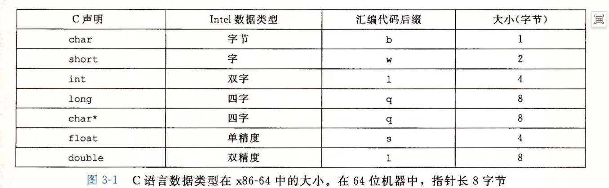

## 3.2
### x86-64 通用寄存器完整对照表（System V ABI）
> 说明：
> 1. 同一行是**同一个物理寄存器**，只是访问宽度不同；
> 2. 写入 32 位子寄存器时，会自动将 64 位寄存器高 32 位清零；写 16/8 位不会修改高位；
> 3. 右侧用途列：Linux System V AMD64 ABI 约定，方便你配合之前的图记忆。


| 64位全名 | 32位子寄存器 | 16位子寄存器 | 8位低字节 | ABI用途说明 |
| -------- | ------------ | ------------ | --------- | ----------- |
| %rax     | %eax         | %ax          | %al       | 函数返回值；调用者保存 |
| %rbx     | %ebx         | %bx          | %bl       | 被调用者保存 |
| %rcx     | %ecx         | %cx          | %cl       | 第4个参数；调用者保存 |
| %rdx     | %edx         | %dx          | %dl       | 第3个参数；调用者保存 |
| %rsi     | %esi         | %si          | %sil      | 第2个参数；调用者保存 |
| %rdi     | %edi         | %di          | %dil      | 第1个参数；调用者保存 |
| %rbp     | %ebp         | %bp          | %bpl      | 栈基址；被调用者保存 |
| %rsp     | %esp         | %sp          | %spl      | 栈指针；特殊寄存器 |
| %r8      | %r8d         | %r8w         | %r8b      | 第5个参数；调用者保存 |
| %r9      | %r9d         | %r9w         | %r9b      | 第6个参数；调用者保存 |
| %r10     | %r10d        | %r10w        | %r10b     | 临时变量；调用者保存 |
| %r11     | %r11d        | %r11w        | %r11b     | 临时变量；调用者保存 |
| %r12     | %r12d        | %r12w        | %r12b     | 被调用者保存 |
| %r13     | %r13d        | %r13w        | %r13b     | 被调用者保存 |
| %r14     | %r14d        | %r14w        | %r14b     | 被调用者保存 |
| %r15     | %r15d        | %r15w        | %r15b     | 被调用者保存 |


### 补充记忆要点

####  调用者保存（Caller-saved / 易失寄存器）

`rax, rcx, rdx, rsi, rdi, r8, r9, r10, r11`


> 函数调用时，被调用函数可以随意覆盖。调用者如果需要保留这些值，必须自己压栈保存。

#### ✅ 被调用者保存（Callee-saved / 非易失寄存器）

`rbx, rbp, r12, r13, r14, r15`

> 如果被调用函数要修改它们，必须在函数开头保存，`ret`返回前恢复原值。调用者放心使用。

#### ✅ 参数传递顺序（前 6 个参数）

`%rdi(1) → %rsi(2) → %rdx(3) → %rcx(4) → %r8(5) → %r9(6)`
 
> 参数≥7 个时，多余参数压入栈。（phase_5中有用到）

#### ✅ 返回值

`%rax` 存放函数返回值；返回值大于 64 位时，`%rdx`存高 64 位。

## 3.3
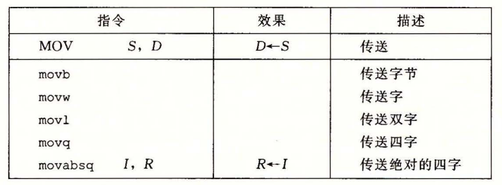

## 3.4
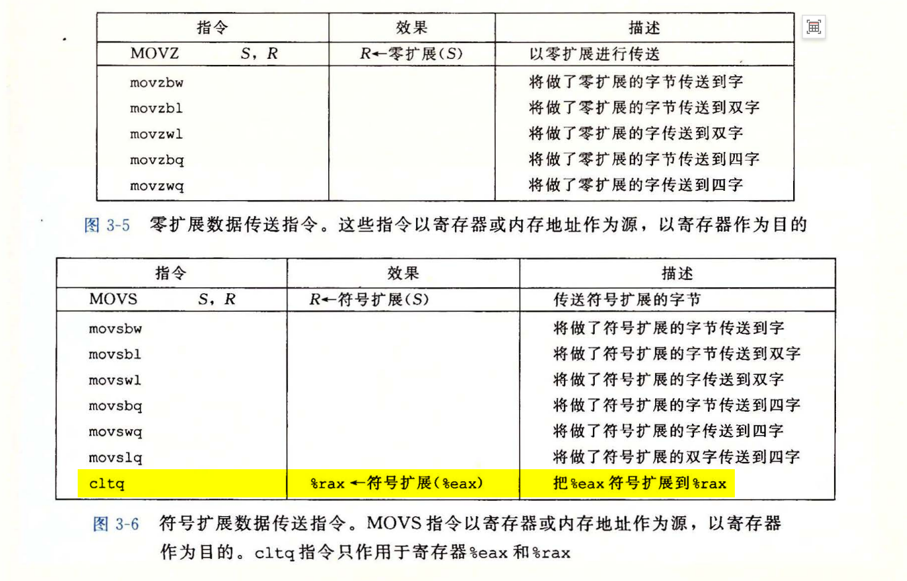
>movabsq 专门用来加载**超过 32 位宽度的 64 位立即常数**到寄存器。


| 类型       | 操作数值名称       | 符号表示                          | 通俗解释 + 例子                                                                 |
| ---------- | ------------------ | --------------------------------- | ------------------------------------------------------------------------------ |
| 立即数     | $Imm               | $Imm                              | 立即数寻址：直接用常数，`movq $5, %rax`，直接把 5 放进 rax寄存器                 |
| 寄存器     | \(r_a\)            | \(R[r_a]\)                        | 寄存器寻址：拿寄存器里面的值，`movq %rbx, %rax`，把 rbx 的值拷贝到 rax           |
| 存储器     | Imm                | \(M[Imm]\)                        | 绝对寻址：Imm 直接当作内存地址，`movq 0x1000, %rax`，去内存地址 0x1000 读数据   |
| 存储器     | \((r_a)\)          | \(M[R[r_a]]\)                     | 间接寻址：寄存器里面保存内存地址，去这个地址读内存。例：`movq (%rbx), %rax`，rbx 存地址 A，读取 M[A] 送入 rax |
| 存储器     | \(Imm(r_b)\)       | \(M[Imm+R[r_b]]\)                 | 基址 + 偏移寻址：基址寄存器 + 常数偏移，非常常用（结构体访问）。`movq 8(%rbx), %rax`：地址 = rbx 的值 + 8，读取该内存 |
| 存储器     | \((r_b, r_i)\)     | \(M[R[r_b]+R[r_i]]\)              | 变址寻址：基址 + 索引，比例因子 s 默认 = 1。`movq (%rbx,%rsi), %rax` 地址 = rbx+rsi |
| 存储器     | \(Imm(r_b, r_i)\)  | \(M[Imm+R[r_b]+R[r_i]]\)          | 变址寻址：基址 + 索引 + 固定偏移                                                 |
| 存储器     | \((,r_i,s)\)       | \(M[R[r_i] \cdot s]\)             | 比例变址寻址：只有索引 × 比例，无基址。`movq (,%rsi,8), %rax` 地址 = rsi ×8     |
| 存储器     | \(Imm(,r_i,s)\)    | \(M[Imm + R[r_i]\cdot s]\)        | 比例变址寻址：常数偏移 + 索引 × 比例                                            |
| 存储器     | \((r_b, r_i, s)\)  | \(M[R[r_b]+R[r_i]\cdot s]\)       | 比例变址寻址：基址 + 索引 × 比例，数组最常用。`movq (%rbx,%rsi,8), %rax` 地址 = rbx + rsi*8 |
| 存储器     | \(Imm(r_b, r_i, s)\)| \(M[Imm+R[r_b]+R[r_i]\cdot s]\)   | 比例变址寻址：完整版通用寻址公式，所有寻址的母版                                 |

## 3.5
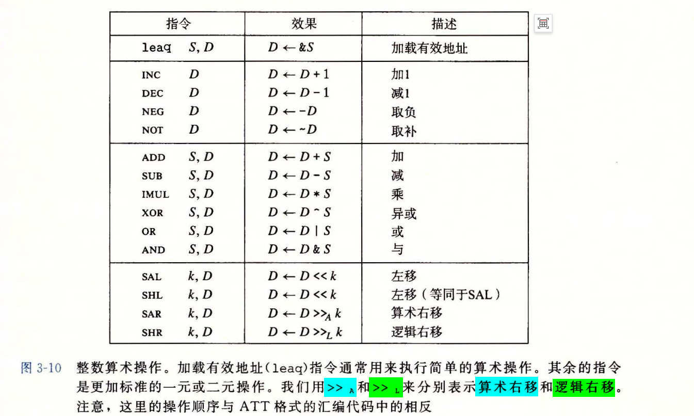
>算数右移：补符号位；逻辑右移：补0.

|类型|定义|可用操作数|指令清单|例子|等价C语言|
|---|---|---|---|---|---|
|**一元操作**|**仅1个操作数，既是源又是目的**|寄存器 / 内存位置|`incq` 自增<br>`decq` 自减<br>`negq` 取负（补码）<br>`notq` 按位取反|`incq (%rsp)`<br>栈顶8字节值+1|`*p++`|
|**二元操作**|**2个操作数：源, 目的**<br>计算：`目的 = 目的 OP 源`|源：立即数/寄存器/内存<br>目的：寄存器/内存（**不能两个都是内存**）|`addq` 加法<br>`subq` 减法<br>`imulq` 乘法<br>`xorq` 异或<br>`orq` 或<br>`andq` 与|`subq %rax, %rdx`<br>含义：`%rdx = %rdx - %rax`|`rdx -= rax`|

### x86-64 移位指令 %cl 截断规则
#### 核心规则
当移位次数存放在 %cl 中时：
CPU **不会直接使用 %cl 完整值**，只会截取 **%cl 的最低 m 位**作为真实移位次数。

#### 对应关系表
| 指令后缀 | 操作位宽 w | m（满足 2^m = w） | 截取 %cl 位数 | 最大有效移位次数 |
| -------- | ---------- | ----------------- | ------------- | ---------------- |
| b 字节   | 8 bit      | 3                 | 低 3 位       | 7                |
| w 字     | 16 bit     | 4                 | 低 4 位       | 15               |
| l 双字   | 32 bit     | 5                 | 低 5 位       | 31               |
| q 四字   | 64 bit     | 6                 | 低 6 位       | 63               |

#### 两种移位写法区别
1. 立即数移位：`shl $n, %reg`
- 直接移 n 位，**无截断**

2. 寄存器移位：`shl %cl, %reg`
- 必须截断，只保留低位
- 移位次数 **永远不会超过上表最大值**

#### 设计原因
超过数据位宽的移位无意义：
- 8位数移8位 = 全部清空
- 硬件直接截断，避免无效操作

#### 经典易错例题
例：%cl = 0x40（二进制 01000000）
执行：`salq %cl, %rax`
- salq 对应截取低6位
- 低6位全0
- 真实移位：**0 位，数值不变**

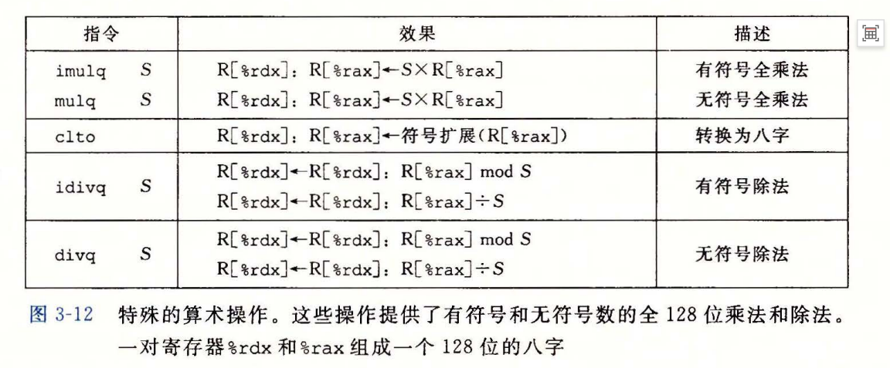

### idivq / divq 笔记
> 书上表格存在印刷笔误：商存入%rax，余数存入%rdx，表格写反。
#### 基础概念
%rdx（高64位）:%rax（低64位）拼接为128位被除数；S为64位除数。
- idivq S：有符号128÷64除法
  - 输入：128位有符号数 %rdx:%rax
  - 输出：%rdx = 余数，%rax = 商
  - 准备：使用cqto，将%rax符号扩展填充到%rdx
- divq S：无符号128÷64除法
  - 输入：128位无符号数 %rdx:%rax
  - 输出：%rdx = 余数，%rax = 商
  - 准备：手动 movq $0, %rdx，将高64位清零

#### cqto（书中clto为笔误）
将%rax符号扩展为128位，生成%rdx:%rax，专供idivq使用。

#### 重要限制
1. 除数S**不能是立即数**，只能是寄存器或内存。
2. 除数为0，或者商超出64位long范围 → 触发硬件异常。


####  例子
- 有符号
```c
long div_test(long x, long y) {
    long q = x / y;   // 商
    long r = x % y;   // 余数
    return q + r;
}
```
``` asm
div_test:
    movq    %rdi, %rax   # 把被除数x放到%rax（低64位）
    cqto                 # 核心！把rax符号扩展到rdx:rax，拼成128位有符号被除数
    idivq   %rsi         # 128位 ÷ %rsi(y)
                         # 执行后：%rax = 商 q；%rdx = 余数 r
    addq    %rdx, %rax   # return q + r
    ret
```
- 无符号
```c
unsigned long udiv_test(unsigned long x, unsigned long y)
{
    unsigned long q = x / y;
    unsigned long r = x % y;
    return q + r;
}
```
```asm
udiv_test:
    movq    %rdi, %rax
    movq    $0, %rdx     # 无符号，高64位直接清零，不能用cqto！
    divq    %rsi         # 无符号除法
    addq    %rdx, %rax
    ret
```

## 3.6
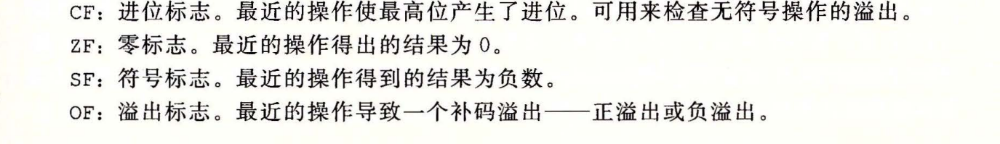
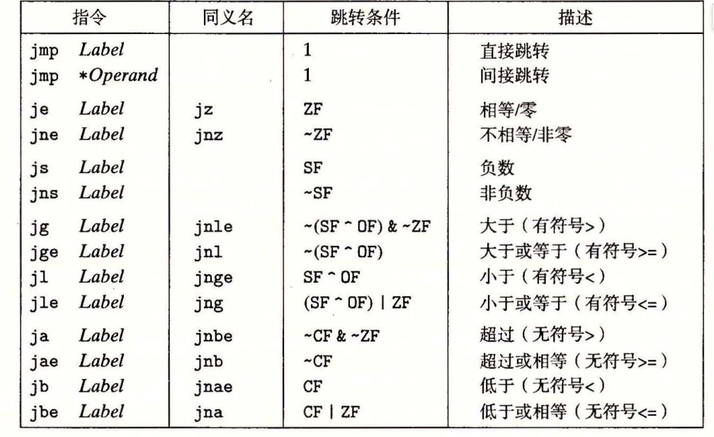
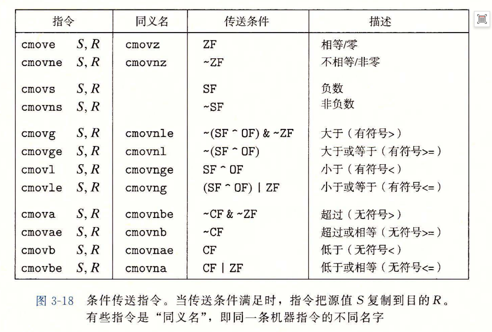

### 条件控制转移与条件数据传送
1. 条件控制转移（jcc 条件跳转指令，分支）
原理：根据标志位，修改 PC，跳转到不同代码块执行。
汇编形态：cmp/test → jXX 跳转，分成两路代码。
```asm
    test %rax,%rax
    je L1
    mov $10, %rbx
    jmp L2
L1: mov $20, %rbx
L2: ...
```
- 优点
适合分支内有大量代码、循环、函数调用的场景；
分支两边计算量很大时，可以跳过不必要的计算，节省指令。
- 缺点
分支预测失败代价极高：CPU 流水线要清空，性能暴跌；
分支不可预测（随机条件）时性能很差。
2. 条件数据传送（cmov 系列条件传送指令，无分支）
原理：不修改 PC，不跳转。两条分支代码都执行，最后根据条件选择把哪个结果写入目标寄存器。
注意：cmov 只会选择寄存器数据，不会执行分支内的内存访问 / 函数调用！
```asm
    mov $10, %rbx
    mov $20, %rcx
    test %rax,%rax
    cmove %rcx,%rbx   ; ZF=1则rbx=rcx，否则rbx保持原值
```
✅ 优点
没有分支、没有跳转，不存在分支预测失败，流水线不会断；
条件随机、难以预测时，性能稳定更好。
❌ 缺点
两边分支的计算都必须执行，如果分支运算代价很大（复杂计算、访存），会浪费 CPU 周期；
不能包含副作用：不能有if里面做数组读写、函数调用，cmov 只能传寄存器值；
cmov 是 x86 特定指令，不是所有处理器都支持。
- 一句话对比总结

项目	条件控制转移（jcc 跳转）	条件数据传送（cmov）
核心机制	修改程序计数器 PC，跳分支	PC 顺序执行，按条件选择寄存器值，不跳转
分支预测	依赖；预测失败开销大	无分支，不依赖分支预测
执行特点	只执行其中一条分支代码	两边表达式都要计算，最后选结果
适用场景	分支代码量大、有函数调用 / 访存	分支仅简单寄存器计算，代码很短


## 3.9
>只有`movaps/movapd`这类**打包对齐移动指令**才强制 16 字节对齐；movsd/movss 不需要 16B 对齐。

## 3.10
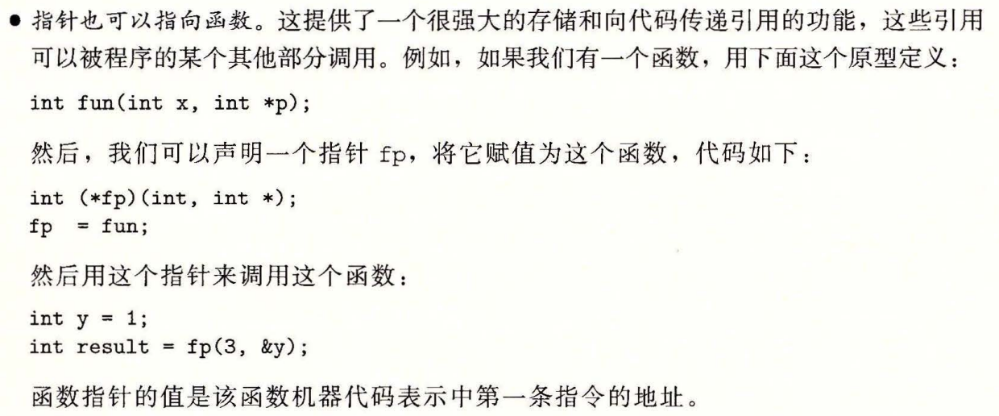

## 3.11
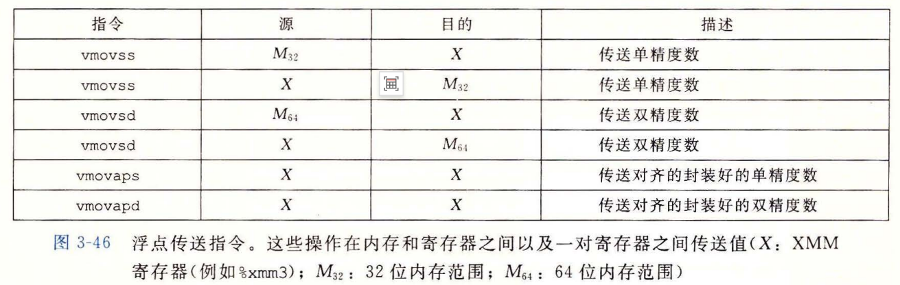

### 双操作数浮点指令与三操作数浮点指令
| 项目 | `cvtsi2ss`（SSE 双操作数） | `vcvtsi2ss`（AVX 三操作数） |
|---|---|---|
| 操作数个数 | 2个 | 3个 |
| 源1 | 整数 | 整数 |
| 源2 | 隐含就是目的寄存器本身 | 独立XMM寄存器 |
| 低32位 | 转换后的浮点数 | 转换后的浮点数 |
| 高位（96bit） | **置0** | **复制源2的高位，保留原值** |
| 源寄存器是否被修改 | 目的寄存器被覆盖 | src1、src2都不会被修改 |

| 项目 | `cvtsi2sd`（SSE 双操作数） | `vcvtsi2sd`（AVX 三操作数） |
|---|---|---|
| 功能 | 32位int转double | 32位int转double |
| 操作数个数 | 2个 | 3个 |
| 低64位 | 转换后的double结果 | 转换后的double结果 |
| 高位（64bit） | **置0** | **复制源2XMM的高位** |
| 寄存器副作用 | 目的XMM被完全重写 | src1、src2保持不变 |

### AVX 打包 SIMD 浮点指令
| 指令 | 全称 | 功能 | 输入(128bit XMM) | 输出(128bit XMM) | 典型用途 |
|---|---|---|---|---|---|
| `vcvtps2pd` | Convert Packed Single to Packed Double | 打包单精度 → 打包双精度，**取低2个float转为2个double** | `[f3,f2,f1,f0]` <br>4个float | `[f1→D1, f0→D0]` <br>2个double | 将一对float提升为double向量做高精度运算 |
| `vcvtpd2ps` | Convert Packed Double to Packed Single | 打包双精度 → 打包单精度，2个double转2个float，高64bit清零 | `[D1,D0]` <br>2个double | `[0,0,D1→f1,D0→f0]` <br>低64bit存2个float | 计算完double向量，转回float向量存回内存 |
| `vunpcklps` | Unpack Low Packed Single | 交错合并两个XMM**低2个float** | src1:`[s3,s2,s1,s0]`<br>src2:`[t3,t2,t1,t0]` | dst:`[t1,s1,t0,s0]` | 重组float，常配合`vcvtps2pd`扩展成双精度 |
| `vunpckhps` | Unpack High Packed Single | 交错合并两个XMM**高2个float** | src1:`[s3,s2,s1,s0]`<br>src2:`[t3,t2,t1,t0]` | dst:`[t3,s3,t2,s2]` | 取高半部分float重组 |
| `vmovddup` | Move Double Duplicate | 复制源最低1个double，广播到XMM两个double槽位 | `[D1,D0]` | `[D0,D0]` | 把单个标量double复制成双元素向量 |
| `vmovsldup` | Move Single Low Duplicate | 复制源低2个float，各自广播 | `[f3,f2,f1,f0]` | `[f1,f1,f0,f0]` | 标量float广播成4个float向量 |

### 浮点运算操作
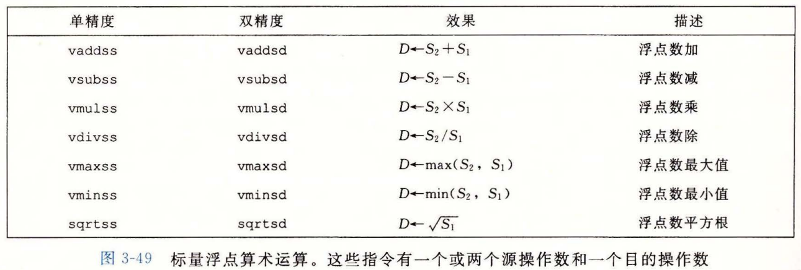

### 浮点位级操作
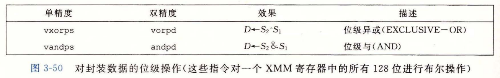

### 比较浮点数大小
| 标志位 | 英文全称 | 中文名称 | 核心含义 | 配套常用指令 |
| ---- | ---- | ---- | ---- | ---- |
| CF | Carry Flag | 进位标志 | 无符号数运算产生进位/借位。<br>`cmp a,b`（b-a）：无符号 `b < a` 时，CF=1 | `ja`、`jb`、`setbe` |
| ZF | Zero Flag | 零标志 | 运算结果为0，ZF=1；结果非0，ZF=0。<br>`cmp a,b`：`b == a` 时 ZF=1 | `je`(`jz`)、`jne`(`jnz`) |
| PF | Parity Flag | 奇偶标志 | 普通整数运算：看**结果低8位**，二进制1的个数为偶数则PF=1，奇数则PF=0。<br>⚠️`vucomiss`浮点数比较：只要任一操作数是NaN，直接置PF=1，不再判断奇偶 | `jp`（PF=1跳转）、`jnp`（PF=0跳转） |

>补充：条件跳转 / set 指令标志判断表

| 指令 | 全称 | 跳转/置位条件 |
| ---- | ---- | ---- |
| ja | jump above | `CF == 0 && ZF == 0` |
| jp | jump parity | `PF == 1` |
| je | jump equal | `ZF == 1` |
| setbe | set byte below or equal | `CF == 1` || `ZF == 1` |


# 做题笔记
## phase_3
1. 应该使用 x/gx,你这里要查看的是一个 8 字节的地址

## phase_4
1. shr：逻辑右移:它不关心这个数是不是负数，永远补 0。
2. sar：算术右移:也是向右移动，但是左边补原来的最高位（符号位）。
3. - 401b61: sar %eax
   - 这是算术右移 1 位，相当于：
   - eax = eax >> 1
   - 但这里前面故意进行了：
   - (c-b) + 符号位
   - 这种写法的目的就是让负数情况下的整数除法向 0 舍入。
   - 最终相当于：
   - eax = (c - b) / 2;
>更准确地说，它实现的是 C 语言整数除法的那种向 0 截断效果。解释一下为什么可以产生向0截断的效果？
>关键就在于：sar 1 本身对负数不是“向 0 舍入”，而是“向负无穷取整”。所以汇编在 sar 之前先给负数加 1，把结果调整一下。

我们只看：x = c - b，而汇编实际上做的是：
```C

if (x < 0)
    x = x + 1;

x = x >> 1;   // sar 1
```

```c
int func_4(int a,int b,int c)
{
    int d;
    int e=(c-b)/2+b;
    if(a<d)
    {
        e=func_4(a,d+1,c);
        return 2e;
    }

    if(d<a)
    {
        e=func_4(a,d+1,c);
        return 2e+1;
    }
    return 0;
}
```

## phase_5
1. add    $0xffffffffffffff80,%rsp是不是等价于sub $0x80 ，%rsp
2. (gdb) disassemble 0x4017bc得到`read_six_numbers的汇编代码`
```asm
Dump of assembler code for function read_six_numbers:
   0x00000000004017bc <+0>:     push   %rbp
   0x00000000004017bd <+1>:     mov    %rsp,%rbp
   0x00000000004017c0 <+4>:     sub    $0x20,%rsp
   0x00000000004017c4 <+8>:     mov    %rdi,-0x18(%rbp)
   0x00000000004017c8 <+12>:    mov    %rsi,-0x20(%rbp)
   0x00000000004017cc <+16>:    mov    -0x20(%rbp),%rax
   0x00000000004017d0 <+20>:    lea    0x14(%rax),%rdi
   0x00000000004017d4 <+24>:    mov    -0x20(%rbp),%rax
   0x00000000004017d8 <+28>:    lea    0x10(%rax),%rsi
   0x00000000004017dc <+32>:    mov    -0x20(%rbp),%rax
   0x00000000004017e0 <+36>:    lea    0xc(%rax),%r9
   0x00000000004017e4 <+40>:    mov    -0x20(%rbp),%rax
   0x00000000004017e8 <+44>:    lea    0x8(%rax),%r8
   0x00000000004017ec <+48>:    mov    -0x20(%rbp),%rax
   0x00000000004017f0 <+52>:    lea    0x4(%rax),%rcx
   0x00000000004017f4 <+56>:    mov    -0x20(%rbp),%rdx
   0x00000000004017f8 <+60>:    mov    -0x18(%rbp),%rax
   0x00000000004017fc <+64>:    push   %rdi
   0x00000000004017fd <+65>:    push   %rsi
   0x00000000004017fe <+66>:    mov    $0x402210,%esi
   0x0000000000401803 <+71>:    mov    %rax,%rdi
   0x0000000000401806 <+74>:    mov    $0x0,%eax
   0x000000000040180b <+79>:    call   0x4010c0 <__isoc99_sscanf@plt>
   0x0000000000401810 <+84>:    add    $0x10,%rsp
   0x0000000000401814 <+88>:    mov    %eax,-0x4(%rbp)
   0x0000000000401817 <+91>:    cmpl   $0x5,-0x4(%rbp)
   0x000000000040181b <+95>:    jg     0x401822 <read_six_numbers+102>
   0x000000000040181d <+97>:    call   0x401825 <explode_bomb>
   0x0000000000401822 <+102>:   nop
   0x0000000000401823 <+103>:   leave  
   0x0000000000401824 <+104>:   ret  
```   
### 1. read_six_numbers 的栈帧结构

假设当前函数的栈帧基准地址为 `rbp`。栈向低地址增长。

| 地址位置 | 保存的内容 | 大小 |
|---|---|---|
| `rbp + 8` | 返回地址 | 8 字节 |
| `rbp` | 调用者之前保存的旧 `rbp` | 8 字节 |
| `rbp - 0x4` | `sscanf` 的返回值，即成功赋值的数量 | 4 字节 |
| `rbp - 0x8` 至 `rbp - 0x17` | 局部栈空间，未见明确的具名变量使用 | 16 字节 |
| `rbp - 0x18` | 输入字符串 `input` 的地址 | 8 字节 |
| `rbp - 0x20` | 数组 `numbers` 的首地址 | 8 字节 |

注意：
- `rbp - 0x18` 保存的是字符串地址，不是字符串内容。
- `rbp - 0x20` 保存的是数组首地址，不是数组中的六个整数。
- 六个整数实际存储在调用者 `phase_5` 的栈帧中。

### 2. phase_5 中 numbers 数组的内存分布

假设 `numbers` 的首地址为 `0x1000`，每个 `int` 占 4 字节。

| 数组元素 | 起始地址 | 占用的地址范围 | 大小 |
|---|---|---|---|
| `numbers[0]` | `0x1000` | `0x1000`–`0x1003` | 4 字节 |
| `numbers[1]` | `0x1004` | `0x1004`–`0x1007` | 4 字节 |
| `numbers[2]` | `0x1008` | `0x1008`–`0x100B` | 4 字节 |
| `numbers[3]` | `0x100C` | `0x100C`–`0x100F` | 4 字节 |
| `numbers[4]` | `0x1010` | `0x1010`–`0x1013` | 4 字节 |
| `numbers[5]` | `0x1014` | `0x1014`–`0x1017` | 4 字节 |

数组元素地址的计算公式：

\[
\operatorname{addr}(\text{numbers}[i])
=0x1000+i\times4
\]

### 对应的汇编指令

| 汇编指令 | 计算结果 | 对应含义 |
|---|---|---|
| `mov %rax, %rdx` | `rdx = 0x1000` | `&numbers[0]` |
| `lea 0x4(%rax), %rcx` | `rcx = 0x1004` | `&numbers[1]` |
| `lea 0x8(%rax), %r8` | `r8 = 0x1008` | `&numbers[2]` |
| `lea 0xc(%rax), %r9` | `r9 = 0x100C` | `&numbers[3]` |
| `lea 0x10(%rax), %rsi` | `rsi = 0x1010` | `&numbers[4]` |
| `lea 0x14(%rax), %rdi` | `rdi = 0x1014` | `&numbers[5]` |

注意：最后两条指令计算出的地址随后通过 `push` 作为 `sscanf` 的额外参数传递。

**核心区别：**
- 地址：表示数据存放的位置。
- 值：表示该位置中实际保存的整数。
- `lea`：计算地址，不读取该地址中的整数值。
- `mov`：根据操作数形式，可以读取内存中的内容，也可以复制寄存器中的值。